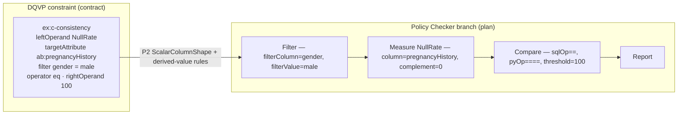
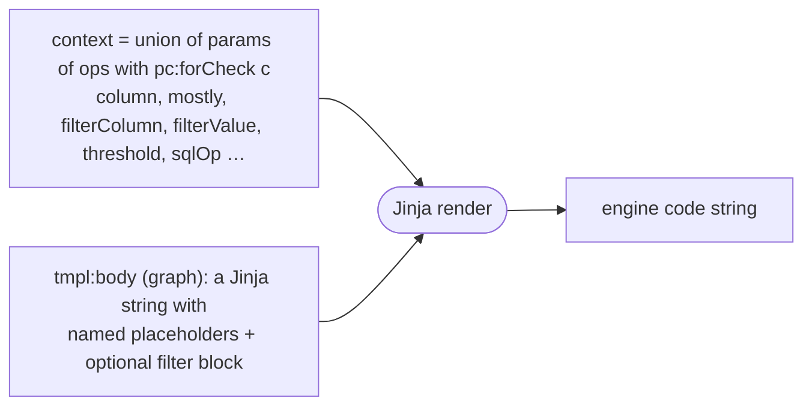
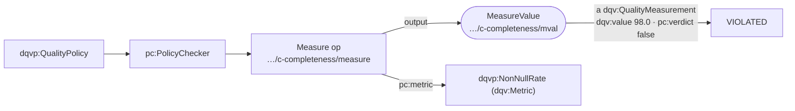

# DQVP → Policy Checker → Code: the model

This documents the refactored pipeline (analysis items 1–6): a distinct, technology-agnostic
**Policy Checker** modelled as a typed dataflow **workflow** with stable IRIs, a single shared
`Load` feeding parallel per-check branches, shape-driven skeletons, and DQV provenance of results.

## 1. Architecture (layers)

```mermaid
flowchart LR
  subgraph contract["Contract — DQVP policy"]
    POL["dqvp:QualityPolicy<br/>+ dqvp:DQConstraint ×N"]
  end
  subgraph plan["Plan — Policy Checker (technology-agnostic)"]
    PC["pc:PolicyChecker<br/>workflow of typed Operations"]
  end
  subgraph code["Code — per engine"]
    GX[GX] & DBT[dbt] & SODA[SodaCL] & DEQ[PyDeequ]
  end
  POL -- "EYE rules/plan.n3 (+vocab,config)" --> PC
  PC -- "1 Jinja binder + templates.ttl" --> GX & DBT & SODA & DEQ
  PC -. "execute + record" .-> MEAS["dqv:QualityMeasurement"]

  classDef c fill:#eef,stroke:#88a; classDef p fill:#efe,stroke:#8a8; classDef g fill:#fee,stroke:#a88;
  class POL c; class PC,MEAS p; class GX,DBT,SODA,DEQ g;
```

Semantics live in N3 (`policy → plan`). Code generation is data: graph-stored Jinja templates
bound by one generic binder. Only mechanical steps (resolve code list, assemble, execute) are Python.

## 2. The Policy Checker graph (one shared Load, parallel branches)

`pc:PolicyChecker` is a **distinct** resource `pc:accordingTo` the policy; every operation and
artifact has a **stable skolem IRI**; operations are **typed** (`pc:Load`/`Filter`/…); artifacts
are typed ports wired by `pc:input`/`pc:output` (the OP input→output shape, after Hmimou et al.). The Load operation has a `Dataset` input carrying `pc:format` + `pc:locator`.

```mermaid
flowchart TD
  POL["dqvp:QualityPolicy<br/>ps-dq-offer-01"] -. "pc:accordingTo" .-> CH["pc:PolicyChecker<br/>…/checker"]
  CH --> WF["pc:Workflow"]
  WF --> LOAD["Load<br/>…/checker/load"]
  LOAD -- output --> T(["Table<br/>…/checker/table"])

  %% completeness branch
  T --> Fa["Filter<br/>c-completeness"] -- ftable --> Ma["Measure<br/>NonNullRate"] --> Ca["Compare"] --> Ra["Report"]
  %% compliance branch (with reference resolution)
  RES["Resolve"] -- output --> CODES(["CodeList"])
  T --> Fb["Filter<br/>c-compliance"] -- ftable --> Mb["Measure<br/>ReferenceConformance"]
  CODES --> Mb
  Mb --> Cb["Compare"] --> Rb["Report"]
  %% consistency branch (row filter)
  T --> Fc["Filter<br/>gender = male"] -- ftable --> Mc["Measure<br/>NullRate"] --> Cc["Compare"] --> Rc["Report"]

  classDef op fill:#efe,stroke:#6a6; classDef art fill:#ffd,stroke:#aa6;
  class LOAD,Fa,Ma,Ca,Ra,RES,Fb,Mb,Cb,Rb,Fc,Mc,Cc,Rc op;
  class T,CODES art;
```

Each `Measure` carries its parameters as `pc:parameter [pc:name ; pc:value]` (e.g. `column`,
`mostly`, `complement`); each `Compare` carries `threshold`, `sqlOp`, `pyOp`; each `Filter`
carries only the **neutral** `filterColumn`/`filterValue` (engine syntax is NOT in the plan).

## 3. DQVP → Policy Checker: the mapping (graph transformation)

One constraint becomes one branch. The shape descriptor (`pc:shape`, data in `config.ttl`)
selects the skeleton rule; the rest is metric/engine-agnostic.



Mapping rules (all generic — none names a metric or engine):

| Contract element | Rule | Plan result |
|---|---|---|
| `dqvp:QualityPolicy` + permission target | P1 | `pc:PolicyChecker` + shared `Load`→`Table` |
| `DQConstraint`, metric `pc:shape ScalarColumnShape` | P2 | `Filter→Measure→Compare→Report` branch (skolem IRIs) |
| `odrl:operator` (via `config.ttl`) | Compare-params | `sqlOp`,`pyOp` on `Compare` |
| rate + `gteq`, `<100` | derived | `mostly = threshold/100` on `Measure` |
| any threshold | derived | `complement = 100 − threshold` on `Measure` |
| `dqvp:referenceStandard` | Resolve | `Resolve`→`CodeList`, `Measure input CodeList` |
| `dqvp:filter` | Filter-params | neutral `filterColumn`/`filterValue` on `Filter` |

## 4. Code generation (Jinja bind = graph transformation)

The binder collects the parameters of the operations that carry `pc:forCheck <check>` into one
context, then renders the `(engine, metric)` template. The plan stays neutral (only
`filterColumn`/`filterValue`/`filterOp`); the binder builds the engine filter clause once —
operator- and set-aware — and injects it as `{{gxFilter}}`/`{{sqlFilter}}`/`{{sodaFilter}}`.



Same `c-consistency` branch, four engines (actual output):

```python
# GX
validator.expect_column_values_to_be_null(column="pregnancyHistory",
    row_condition='gender=="male"', condition_parser="pandas")
```
```sql
-- dbt (c-consistency)
with m as (select 100.0*(count(*)-count("pregnancyHistory"))/nullif(count(*),0) as r
           from {{ source('ehds','patient_summary') }} where "gender" in ('male'))
select r from m where not (r = 100)
```
```yaml
# SodaCL
  - missing_percent(pregnancyHistory) = 100:
      name: c-consistency
      filter: gender IN ('male')
```
```python
# PyDeequ
    .hasCompleteness("pregnancyHistory", lambda x: x == 0.0)  # c-consistency
```

**Data-format dimension.** The *check* code above is format-agnostic; only the **Load**
operation's code depends on the format. The `Dataset` input of `Load` carries `pc:format` +
`pc:locator` (from the data-product descriptor `dataset_*.ttl`), and a separate set of
**load templates** is keyed by `(engine, format)`:

```text
csv  →  gx: pd.read_csv('…')        duckdb: read_csv_auto('…')
json →  gx: pd.read_json('…')       duckdb: read_json_auto('…')
parquet → gx: pd.read_parquet('…')  duckdb: read_parquet('…')
```

The same plan therefore validates CSV, JSON or Parquet — only the load swaps. (Verified live on
CSV, JSON and Parquet with identical verdicts in `../operationalization.ipynb` (repo root).)

## 5. Provenance of results (DQV)

Execution records a `dqv:QualityMeasurement` on the workflow's `MeasureValue` artifact, closing
the chain contract → plan → operation → artifact → measurement.



## 6. Extensibility

| Change | What you edit | Rules touched |
|---|---|---|
| New engine | template rows in `templates.ttl` | none |
| New metric, existing shape | a `config.ttl` shape row + template rows | none |
| New metric **shape** (e.g. table-level) | one skeleton rule + templates | one |
| New operator | one row in `config.ttl` | none |
| New **data format** (json, parquet, …) | a `(engine, format)` load template row | none |

`run.py` prints the workflow, the generated code, and the execution+measurements; the graph
artifacts are written to `artifacts/plan.ttl` and `artifacts/measurements.ttl`.

## 7. Known limitations

- PyDeequ has no native row filter, so the conditional check (`c-consistency`) carries an
  explicit note rather than emitting a silently-wrong constraint.
- The plan assumes a single permission/asset and carries parameters as strings.
- SQL identifiers are not escaped; reference-standard resolution is wired for ISO 3166 only.
